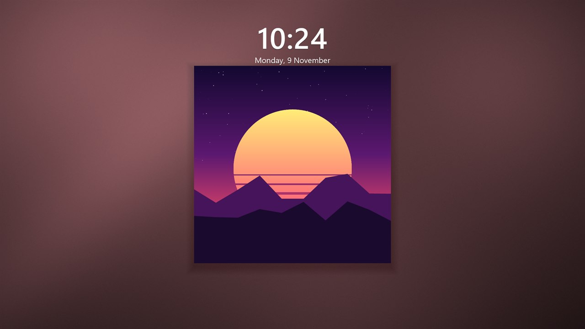
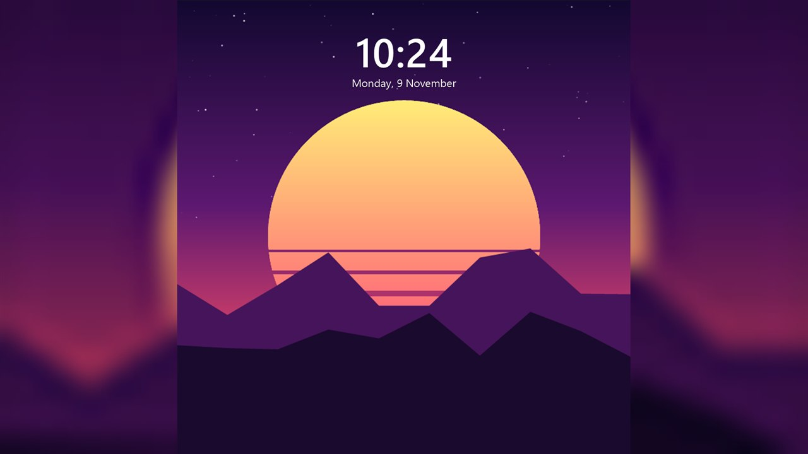
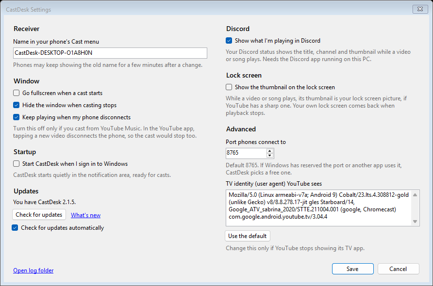

<p align="center">
  
</p>

<h1 align="center">CastDesk</h1>

<p align="center">
  Cast YouTube from your phone to your Windows PC.<br />
  Your phone's YouTube app finds the PC in its Cast menu, the same way it finds a smart TV, and the video plays on the
  PC in YouTube's own TV app.
</p>

---

## Contents

- [Why CastDesk](#why-castdesk)
- [Features](#features)
- [Requirements](#requirements)
- [Installing and running](#installing-and-running)
- [Using CastDesk](#using-castdesk)
  - [Casting from your phone](#casting-from-your-phone)
  - [Signing in](#signing-in)
  - [The player window](#the-player-window)
  - [Tray icon](#tray-icon)
  - [Volume mixer and media controls](#volume-mixer-and-media-controls)
  - [Lock screen](#lock-screen)
- [Settings](#settings)
  - [Updates](#updates)
- [Settings file](#settings-file)
- [How it works](#how-it-works)
- [Troubleshooting](#troubleshooting)
- [Limitations](#limitations)
- [Privacy and terms](#privacy-and-terms)
- [Building from source](#building-from-source)
- [Project structure](#project-structure)

## Why CastDesk

Windows can't receive a cast from the YouTube app. CastDesk adds that without a browser extension or stream ripping:
it runs YouTube's own TV app (youtube.com/tv) in a window, so playback, quality (up to 4K), captions, sign-in and
the phone connection are all YouTube's, as on a TV.

## Features

- **Shows up in the phone's Cast menu** as **CastDesk-*PC name*** (for example CastDesk-ARCANE), on every network
  adapter. Phones keep showing that name once connected, including a second phone that joins. The phone's
  controls work as with a TV: play, pause, seek, next, the queue, and picking another video.
- **Starts in the tray** and comes to the front when you cast; hides again a few seconds after you stop.
- **Up to 4K** (2160p, up to 60 fps), and **HDR** when HDR is on in Windows' display settings. Pick the quality in
  the TV app's player settings; Auto may choose 4K even on a smaller screen.
- **Keeps playing while minimized**, and the phone's controls still work. Previews on the TV app's home screen
  stop until you restore the window.
- **Music keeps playing in the tray:** close the window during a song and it keeps playing, with the phone still in
  control. Close it during any other video and the video pauses; play it again from the phone and the window comes
  back.
- **Nothing else plays in the background:** closing the window on the home screen unloads the TV app, and after
  5 minutes in the tray CastDesk closes its browser too, freeing its memory. The next cast starts it again.
- **Fullscreen** with F11, Alt+Enter or a button, and a **Back** button for the TV app.
- **Named "CastDesk" in Windows:** in the volume mixer and the media controls (with title, play/pause and next/previous),
  instead of "Microsoft Edge WebView2" and "Unknown app". Media keys work.
- **Signed in once:** your YouTube sign-in is kept in CastDesk's own browser profile.
- **Settings window** for the name, window behaviour, what happens when your phone disconnects, starting with
  Windows, updates, Discord, the lock screen, the port and the TV identity.
- **Shows what's playing in Discord** (on by default, turn it off in Settings): "Listening to" for music, "Watching" for other
  videos, with the title, channel, thumbnail, time left and a link to the video.
- **Thumbnail on the lock screen** (on by default, turn it off in Settings): while something plays, its thumbnail sits
  in the middle of the Windows lock screen, half the screen wide, on frosted, glossy glass tinted with the
  thumbnail's main colour, or filling the screen if you prefer. Your own lock screen comes back afterwards.
- **Updates from inside the app:** CastDesk checks GitHub for a new version, and downloads, verifies and installs it.

## Requirements

- Windows 10 version 2004 or later, or Windows 11 (x64)
- Microsoft Edge WebView2 Runtime (included with Windows 11; CastDesk tells you if it's missing)
- The phone and the PC on the same network
- The YouTube app on the phone
- Optional: the Discord desktop app, to show what's playing as your Discord status (CastDesk 2.1.4 or later)

## Installing and running

Download `CastDesk-<version>-x64.msi` from the [latest release](https://github.com/Shyam-Sangeeth/CastDesk/releases/latest)
and run it. Windows asks for admin rights, since CastDesk installs for all accounts on the PC.

- **Welcome screen:** **Start CastDesk when Windows starts** is ticked for a new install; untick it if you'd rather
  start CastDesk yourself. You can change it later in [Settings](#settings).
- **Where to install:** `C:\Program Files\CastDesk` by default; **Change...** picks another folder or drive.
- The installer adds a Start menu shortcut, an entry in **Settings → Apps**, and a Windows Firewall rule that lets
  phones on your local network reach CastDesk. CastDesk is self-contained, so .NET doesn't need to be installed.
- When it finishes, CastDesk starts in the notification area (tray). Only one copy runs at a time.

**Upgrading:** use **Settings… → Updates** in CastDesk (see [Updates](#updates)), or run a newer MSI yourself. Either
way it closes CastDesk, installs where the last version went, starts it again, and keeps your settings and YouTube
sign-in (`%LOCALAPPDATA%\CastDesk`). Windows asks for admin rights each time. CastDesk 2.0.0 has no updater, so install
2.1.0 or later from the releases page by hand once; after that, updates come through Settings.

**Uninstalling:** **Settings → Apps → CastDesk → Uninstall**. That removes the program, the Start menu shortcut, the
firewall rule and the startup entry. Your settings, sign-in and log stay in `%LOCALAPPDATA%\CastDesk`; delete that
folder to remove them too. The media-controls name under `HKCU\Software\Classes\AppUserModelId\CastDesk.Receiver` also
stays (it's harmless; delete the key if you like).

Release notes for each version are on the [releases page](https://github.com/Shyam-Sangeeth/CastDesk/releases).

To run CastDesk without installing it, build it (see [Building from source](#building-from-source)).

### Windows Firewall

Phones reach CastDesk on TCP port 8765 (DIAL) and UDP port 1900 (SSDP discovery). The installer adds a firewall rule
for this (local network only). If you run CastDesk without installing it, Windows asks the first time whether to allow
it: allow it. To add the rule yourself, from an administrator PowerShell:

```powershell
New-NetFirewallRule -DisplayName "CastDesk" -Direction Inbound -Program "<path to>\CastDesk.exe" -Action Allow -Profile Private,Public
```

If Windows has reserved port 8765 (Hyper-V and WSL reserve port ranges, which can move after a reboot), CastDesk uses
a free port instead; phones find it either way.

Web pages can't use this port: CastDesk turns away requests that come from a website open in a browser (by their
`Origin` header) and requests addressed to a website's name instead of an IP address, so a page can't open or stop
the player or read its pairing details. Phones' YouTube apps aren't affected. The log shows each refusal as `403`.

## Using CastDesk

### Casting from your phone

In the YouTube app on your phone, tap **Cast** and choose **CastDesk-*your PC's name***. The player window comes to the
front and YouTube's TV app opens the video. Control it from the phone as you would a TV. When the phone stops casting,
the window hides to the tray after 3 seconds (you can turn that off).

Another way to connect, without the Cast menu: in the TV app open **Settings → Link with TV code**, and on the phone
go to **YouTube settings → Watch on TV → Enter TV code**. The phone then lists the PC under its CastDesk name too.

### Signing in

Signing in is optional but gives you your recommendations, subscriptions and Premium. Click **Show Player** in the
tray menu, choose sign-in in the TV app, and enter the code it shows at yt.be/activate on your phone. The sign-in is
kept in CastDesk's own browser profile (`%LOCALAPPDATA%\CastDesk\WebView2`), separate from Edge.

### The player window

You can also use the TV app on the PC directly: **Show Player**, then the keyboard or mouse.

| Key or action | Effect |
|---|---|
| F11, Alt+Enter, or the button in the top-right corner | Fullscreen on/off (the button appears when you move the mouse) |
| Esc, or the arrow button in the top-left corner | The TV app's Back (the button appears when you move the mouse, except on the home screen) |
| Arrow keys, Enter | Move around the TV app and pick |
| Window close button | Hide to the tray. During **music** (YouTube marks songs, music videos and podcast episodes), it keeps playing and the phone stays connected. During **any other video**, the video pauses and the phone stays connected; when it plays again (from the phone, the media keys or Windows' media controls), the window opens again. Anywhere else, such as the home screen, the TV app is unloaded so nothing plays in the background, and a cast or **Show Player** opens it again. |
| Minimize | A video keeps playing. Previews on the home screen and in search stop until you restore the window. |

### Tray icon

Left-click shows the player. Right-click opens the menu:

| Item | What it does |
|---|---|
| Status | The receiver status, for example "Ready. Cast to "CastDesk-ARCANE" from the YouTube app." |
| **Show Player** | Shows the window and the TV app's home screen |
| Reload YouTube | Reloads the TV app (for playback problems) |
| Restart Receiver | Restarts discovery; phones may need to reopen their Cast menu |
| Settings… | Opens [Settings](#settings) |
| Exit | Quits CastDesk; phones drop it from their Cast menu |

### Volume mixer and media controls

CastDesk shows up as **CastDesk** in Windows' volume mixer and in the media controls (Quick Settings and the volume
flyout), with the video's title, play/pause and next/previous. The keyboard's media keys work too. Apps that name sound
by program file instead, such as SteelSeries Sonar, still show "Microsoft Edge WebView2". The media controls get the
name from CastDesk's Start menu shortcut, which the installer creates (since 2.1.1), so a copy you run without
installing shows there as "Unknown app".

### Lock screen

While a video or song plays, its thumbnail is your lock screen picture, so you can see what's playing when you lock
the PC (Win+L). Choose the look in [Settings](#settings) under **Look**:

| Centred, on tinted glass (default) | Fill the screen |
|---|---|
|  |  |
| Half the screen wide, on frosted, glossy glass tinted with the thumbnail's main colour. Works with smaller thumbnails, so older videos show too. | The thumbnail fills the screen. A square album cover sits over a blurred copy of itself. Needs a large thumbnail. |

Both show a song's square cover without the gray bars YouTube adds around it. Windows' clock stays on top as usual;
Windows Spotlight's "Learn more about this picture" links are hidden while the thumbnail shows. When playback stops, your own lock screen comes back after five seconds. (The pictures above use a made-up album cover;
CastDesk's own code drew them.)

## Settings

Open **Settings…** from the tray menu. Changes take effect when you click **Save**; there's no need to restart
CastDesk. The general settings and updates are on the left, the advanced ones on the right.



| Setting | Default | What it does |
|---|---|---|
| Name in your phone's Cast menu | CastDesk-*PC name* | What phones list, in the Cast menu and once connected. They may show the old name for a few minutes after a change; once connected, the new name is used the next time the player opens. |
| Go fullscreen when a cast starts | Off | Switches the window to fullscreen whenever a phone casts. |
| Hide the window when casting stops | On | Hides the window to the tray 3 seconds after the phone stops casting. |
| Keep playing when my phone disconnects | On | **Disconnect from TV** on the phone leaves the video playing, and your phone is free again. Turn this off to stop the player 5 seconds after the last connected phone disconnects; it then goes back to the home screen, or hides if the setting above is on. This works best with YouTube Music: in the YouTube app, tapping a new video while casting plays it on the phone and disconnects it, so the cast stops too. To keep the cast going there, use **Play next** or **Add to queue**. |
| Start CastDesk when I sign in to Windows | Off (the installer offers to turn it on) | Adds CastDesk to your startup apps, starting quietly in the tray. |
| Check for updates automatically | On | Checks for a newer release 30 seconds after CastDesk starts (see [Updates](#updates)). |
| Show what I'm playing in Discord | On | While a video or song plays, your Discord status shows it: **Listening to** for music, **Watching** for other videos, with the title, channel, thumbnail, a progress bar and a **Listen on YouTube** or **Watch on YouTube** button. Your Discord friends see this; turn it off if you'd rather they didn't. Nothing shows while paused or on the home screen. Needs the Discord app running on this PC; CastDesk connects to it on its own (no sign-in). |
| Show the thumbnail on the lock screen | On | While a video or song plays, its thumbnail is your lock screen picture, in the **Look** below ([pictures](#lock-screen)). Anyone who can see the locked screen sees it. A video whose thumbnail is too small for the look you chose leaves your lock screen as it is (rare when centred). See [How it works](#how-it-works) for what happens to Spotlight and slideshows. |
| Look (lock screen) | Centred, on tinted glass | **Centred, on tinted glass** puts the thumbnail in the middle, half the screen wide, on frosted glass in its main colour. **Fill the screen** makes it fill the lock screen; a thumbnail that isn't the shape of your screen (a square album cover) sits whole over a blurred copy of itself. A change redraws the picture straight away. |
| Port phones connect to | 8765 | If Windows has reserved it or another app uses it, CastDesk picks a free one. |
| TV identity (user agent) YouTube sees | A Chromecast with Google TV | Change it only if YouTube stops showing its TV app; **Use the default** puts it back. |

**Open log folder** opens `%LOCALAPPDATA%\CastDesk`, which holds the log.

### Updates

The **Updates** section shows which version you have.

- **Check for updates** looks for a newer [release on GitHub](https://github.com/Shyam-Sangeeth/CastDesk/releases).
- If there is one, **Download and install** downloads its installer and checks it: the size, and the SHA-256 checksum
  GitHub publishes. It then runs the installer. Windows asks for admin rights, then CastDesk closes, is upgraded with
  your settings and sign-in kept, and starts again. Closing the Settings window during the download cancels it.
- **What's new** opens the release notes.
- With **Check for updates automatically** on (the default), CastDesk checks once, 30 seconds after it starts. If
  there's a newer version, it shows a notification; click it to open Settings and update. A failed check is only
  written to the log.

The installer is downloaded to `%TEMP%\CastDesk\update`. Updating is meant for CastDesk installed with the MSI: a copy
you built yourself also offers updates, but installing one adds a separate, installed copy.

## Settings file

Everything CastDesk keeps is in `%LOCALAPPDATA%\CastDesk`:

| File | What it holds |
|---|---|
| `settings.json` | The settings above: `FriendlyName`, `FullscreenOnCast`, `HideWhenCastingStops`, `KeepPlayingWhenPhoneDisconnects`, `CheckForUpdates`, `ShowInDiscord`, `ShowOnLockScreen`, `LockScreenFillsScreen`, `DialPort`, `UserAgent` (empty means the default). Missing fields keep their defaults. |
| `device-id.txt` | The ID phones remember CastDesk by. Keep it, or phones will list CastDesk twice for a while. |
| `WebView2\` | The TV app's browser profile, with your YouTube sign-in. Deleting it signs you out. |
| `castdesk.log` | The log. A new one starts at 1 MB, keeping the previous one as `castdesk.log.old`. |
| `LockScreen\` | Only while a thumbnail is your lock screen: the picture, and what's needed to put your own lock screen back. Emptied afterwards. |

In the registry:

| Key | What it holds |
|---|---|
| `HKCU\Software\Microsoft\Windows\CurrentVersion\Run`, value `CastDesk` | The startup entry, while **Start CastDesk when I sign in** is on |
| `HKCU\Software\Classes\AppUserModelId\CastDesk.Receiver` | CastDesk's name and icon for Windows' media controls (written each time CastDesk starts) |
| `HKLM\Software\CastDesk\Installer` | The install folder, so upgrades install in the same place (installer only) |
| `HKCU\Software\CastDesk\Installer` | A marker for the Start menu shortcut (installer only) |

## How it works

1. **Discovery (SSDP).** CastDesk answers the phone's "any TVs here?" multicast searches on UDP 1900 and announces
   itself every few minutes, on every network adapter. The answer points at a device description on port 8765.
2. **Launch (DIAL).** When you pick CastDesk, the phone sends `POST /apps/YouTube` with a pairing code and the video
   to play. CastDesk opens `youtube.com/tv` with that launch data in its window.
3. **Pairing.** YouTube's TV app uses the pairing code to join the phone's casting session through YouTube's servers,
   and reports its screen details to an `additionalDataUrl`. CastDesk answers that request inside WebView2 and serves
   the details at `GET /apps/YouTube`, where the phone reads them. From then on the phone and the TV app talk through
   YouTube directly, as with a real TV.
4. **The TV identity.** youtube.com/tv only serves its TV app to TV browsers, so CastDesk's WebView2 presents a
   Chromecast with Google TV's user agent. On its own, the TV app would then tell YouTube it is "YouTube on TV", model
   "Sabrina" (that Chromecast's codename), and phones that join through YouTube's servers would show that name. The
   script described below swaps CastDesk's name into those requests (`name` and `deviceInfo.model` on
   `/api/lounge/bc/bind`). Linked-TV lists may still show it as a Google device.
5. **Windows labels.** The TV app's sound is played by WebView2's own processes, so Windows would call it "Microsoft
   Edge WebView2" in the volume mixer and "Unknown app" in the media controls. CastDesk renames its WebView2 audio
   sessions to "CastDesk" (Core Audio API), turns WebView2's media controls off, and registers its own on its window,
   fed by a small script in the TV app. So that Windows can name those controls, CastDesk uses the app ID
   `CastDesk.Receiver` and registers its name and icon for it. Windows' media controls look the ID up through the
   Start menu shortcut that carries it (`System.AppUserModel.ID`), so the installer sets that ID on its shortcut.
6. **Behaving like a TV.** The same script fixes two things that differ between a PC window and a TV:
   - **Minimizing.** A minimized window counts as hidden, and the TV app stops its video while hidden (on a TV that
     means you left the app). While a video is open (the TV app's `#/watch` page), the script tells the TV app
     the page is visible, so the video keeps playing. Anywhere else it passes on the truth, so home-screen
     previews stop.
   - **Quality.** The TV app asks the browser whether it can play formats with details such as `width=3840`, and
     also asks about impossible ones (`width=99999`) to check the answers. Chromium ignores those details and says
     yes to everything, so the TV app wouldn't trust it and offered only up to 720p. The script says no to
     impossible values, and to HDR unless Windows' HDR is on, so the TV app offers up to 4K.
7. **Music in the tray.** The script also reports whether the open video is music: YouTube's player data gives songs,
   music videos and podcast episodes a `musicVideoType` (for example `MUSIC_VIDEO_TYPE_OMV`), and other videos have
   none. Closing the window during music only hides it; closing it during another video hides it and pauses the
   video, and CastDesk shows the window again when that video plays. If the TV app goes back to its home screen
   while CastDesk is in the tray, or the phone disconnects, CastDesk unloads the TV app. Once it has been unloaded for
   5 minutes, CastDesk also closes WebView2's browser processes, which hold a few hundred MB even on a blank page; the
   next cast or **Show Player** starts them again, a second or two slower, and your sign-in is kept.
8. **Discord.** With **Show what I'm playing in Discord** on, CastDesk sets your Discord status through the Discord
   app's local connection on this PC (Discord's Rich Presence, a named pipe), so nothing goes through another
   server. The name and cover come from CastDesk's application in Discord's developer portal. The thumbnail is
   YouTube's, and the small CastDesk icon is loaded from this repository (`docs/discord/discord-icon.png`).
   Pausing, going back to the home screen or turning the option off clears the status, and quitting CastDesk
   closes the connection, which clears it too. Discord accepts only a few updates per 20 seconds, so CastDesk sends
   one only when something changes (a new video, play or pause, a seek). Discord links each status to a running
   process and treats it as a game; CastDesk names its windowless WebView2 process, so Discord's game overlay doesn't
   appear over the player window.
9. **Phones disconnecting.** **Disconnect from TV** on the phone sends CastDesk's receiver nothing, and the phone keeps
   checking in. It reaches the TV app over YouTube's own connection, which lists the phones connected to it, so
   `page-bridge.js` counts them. That way one of two phones leaving doesn't count as the last one leaving.
10. **Lock screen.** An app can't draw over the lock screen, so with **Show the thumbnail on the lock screen** on,
   CastDesk replaces the lock screen picture while something plays. It does this as playback starts, not when the PC
   locks, because Windows takes about a second to apply a picture and your own lock screen would show first. It uses
   the sharpest thumbnail YouTube has. Filling the screen, it needs one at least 600 pixels on its shorter side (most
   videos have a 1280×720 one); centred, where it's only half the screen wide, 340 pixels is enough, so older videos
   with only a 640×480 thumbnail still show. Smaller than that, it leaves your lock screen alone.
   By default the picture puts the thumbnail in the middle at half the screen's width, on frosted glass in the
   thumbnail's main colour; with **Look: Fill the screen** the thumbnail fills it instead. Either way, the bars YouTube
   adds beside album covers are cropped off, so a song shows just its square cover.

   Setting a picture turns off Windows Spotlight and slideshows. CastDesk also turns off "Get fun facts, tips, tricks,
   and more on your lock screen", so Spotlight's "Learn more about this picture" links don't sit on the thumbnail. It
   first saves your settings and a copy of your picture in `LockScreen\`. Five seconds after playback stops it puts
   them back, or at its next start if it crashed. If you choose another lock screen in Windows Settings during
   playback, CastDesk keeps your choice and puts your fun facts setting back.
   Windows reads the Spotlight switch only as the lock screen starts, so if playback stops while the PC is locked,
   you see your underlying Windows picture until the next lock, when Spotlight returns. The Spotlight and slideshow
   switches aren't documented by Microsoft, so a Windows update could change them. Spotlight and plain pictures were
   tested on Windows 11; putting a slideshow back wasn't. PCs whose lock screen is set by a policy are left alone.

## Troubleshooting

- **Log file:** `%LOCALAPPDATA%\CastDesk\castdesk.log`. Lines marked `[dial]` show each request from a phone.
- **CastDesk isn't in the Cast menu:** check that the phone and PC are on the same network and that Windows Firewall
  allows CastDesk.exe, then use **Restart Receiver**.
- **The phone sees CastDesk but casting fails, and the log shows `403`:** CastDesk turned the request away as one
  from a web page (see [Windows Firewall](#windows-firewall)). The `[dial]` line shows the request's `Origin`;
  please [open an issue](https://github.com/Shyam-Sangeeth/CastDesk/issues) with that line.
- **The first cast after a while takes a moment longer:** after 5 minutes in the tray with nothing playing, CastDesk
  closes its browser to free memory, and a cast starts it again. That's normal.
- **A phone shows "Sabrina" or "YouTube on TV" instead of CastDesk's name:** that's the TV app's name from before
  CastDesk 2.1.7. Update CastDesk, then disconnect the phone and cast again.
- **CastDesk appears twice:** the phone still remembers an older entry. It disappears within about 30 minutes, or
  sooner if you turn the phone's Wi-Fi off and on.
- **YouTube says this browser isn't supported, or the TV app looks wrong:** YouTube may have stopped accepting the TV
  identity. Enter a different one under **Settings… → Advanced**.
- **Playback problems:** use **Reload YouTube** in the tray menu.
- **"CastDesk is already running":** only one copy runs at a time. Look for its icon in the notification area (it may
  be under the **^** arrow), or close the other copy with **Exit** in its tray menu.
- **The media controls say "Unknown app":** install CastDesk 2.1.1 or later with the MSI (earlier installers didn't
  give the Start menu shortcut CastDesk's app ID), and start CastDesk from the Start menu or the tray, not from a
  copy you built.
- **Couldn't check for updates:** CastDesk needs to reach `api.github.com`. GitHub also limits how often one network
  can ask (60 times an hour), so try again later. Lines marked `[update]` in the log show what happened. You can
  always download the latest MSI from the releases page and run it.
- **An update didn't install:** CastDesk closes as soon as the installer starts, so if you declined the admin prompt,
  CastDesk isn't running. Start it from the Start menu (it's still the old version) and use **Download and install**
  again.
- **Nothing shows in Discord:** turn on **Settings… → Discord**, make sure the Discord desktop app is running, and
  check that **Share my activity** is on in Discord's **Activity Privacy** settings. CastDesk only shows something
  while a video plays. Lines marked `[discord]` in the log show the connection.
- **Discord's overlay appears over CastDesk:** CastDesk 2.1.4 avoids it. If you still see it, turn the overlay off
  for CastDesk in Discord's **Game Overlay** (or **Registered Games**) settings.
- **The player keeps playing after disconnecting:** that's the default. Turn off **Settings… → Keep playing when my
  phone disconnects**. A `[tv] Phones connected:` line in the log shows each change.
- **No thumbnail on the lock screen:** check **Settings… → Lock screen** is on. A video whose thumbnail is too small
  for the look you chose is skipped (try **Look: Centred**, which needs a smaller one), and a lock screen set by your
  workplace is left alone. Lines marked `[lock]` in the log say why.
- **A thumbnail stayed on the lock screen, or Spotlight, your slideshow or "Get fun facts, tips, tricks, and more"
  didn't come back:** start CastDesk once, which retries, then lock again. If that doesn't help, set your lock screen
  again under Windows' **Settings → Personalization → Lock screen**.

## Limitations

- **YouTube only.** Netflix casts only to devices Netflix has certified, and Spotify's PC app already shows up in the
  phone's Spotify device list by itself.
- **No screen mirroring.** Windows' Miracast receiver API can't be used from a desktop app, and iPhone (AirPlay) and
  Pixel (Google Cast) mirroring would need their protocols reverse-engineered.
- **Google Cast apps other than YouTube** don't see CastDesk: it's a DIAL receiver, not a Chromecast.

## Privacy and terms

CastDesk has no servers, accounts or analytics; it keeps its settings and log on your PC. The
[privacy policy](PRIVACY.md) lists what it connects to (your phone, YouTube, GitHub for updates, and the Discord app
on your PC while the Discord option is on), and the [terms of service](TERMS.md) cover using it.

## Building from source

Needs the [.NET 10 SDK](https://dotnet.microsoft.com/download/dotnet/10.0).

```powershell
dotnet build -c Debug       # bin\Debug\net10.0-windows10.0.19041.0\win-x64\CastDesk.exe
dotnet build -c Release     # bin\Release\net10.0-windows10.0.19041.0\win-x64\CastDesk.exe
dotnet run                  # build and start (in the tray)
```

A running CastDesk locks its exe: use **Exit** in the tray menu (or `CastDesk.exe --exit`) before building. The README
screenshots are made by `tools/readme-shots` (see [tools/README.md](tools/README.md)).

If CastDesk is also installed, only one copy can run at a time: the second one says CastDesk is already running and
closes. Exit the installed copy before starting your build (`& "C:\Program Files\CastDesk\CastDesk.exe" --exit`),
and start it again from the Start menu when you're done. Both copies share the same settings, sign-in and device ID,
so phones see one CastDesk either way. A build you run yourself shows as "Unknown app" in the media controls (it has no
Start menu shortcut), and Windows Firewall asks about it the first time it starts.

### Building the installer

The installer is built with [WiX Toolset](https://wixtoolset.org/) 5, which `dotnet build` downloads by itself:

```powershell
powershell -ExecutionPolicy Bypass -File installer\build-installer.ps1             # version from CastDesk.csproj
powershell -ExecutionPolicy Bypass -File installer\build-installer.ps1 -Version 2.2.0
```

It publishes a self-contained build into `installer\payload` and writes `installer\out\CastDesk-<version>-x64.msi`.
`installer\make-installer-art.ps1` redraws the installer's artwork (`dialog.bmp`, `banner.bmp`).

### Command-line options

The installer uses these; each does its job and returns without starting CastDesk.

| Option | What it does |
|---|---|
| `--exit` | Closes a running CastDesk and waits for it to quit |
| `--add-startup` | Turns on **Start CastDesk when I sign in to Windows** |
| `--remove-startup` | Turns it off |

## Project structure

```
CastDesk.csproj
Program.cs             Entry point: single instance, command-line options, WebView2 check, app ID
MainForm.cs            Player window, tray icon, fullscreen, show/hide on cast, music in the tray
CastDeskController.cs  Runs discovery and passes launch/stop requests to the window
Dial/
  SsdpAdvertiser.cs    SSDP: answers phones' searches and announces CastDesk
  DialHttpServer.cs    DIAL: device description, the YouTube app (launch, status, stop)
  HttpMessages.cs      Minimal HTTP request reading and response writing
Tv/
  TvAppView.cs         YouTube's TV app in WebView2, with the TV identity
  page-bridge.js       Injected into the TV app: media state, fullscreen keys, Back and Fullscreen buttons,
                       videos playing while minimized, format answers (qualities above 720p), connected phones,
                       CastDesk's name on YouTube's connection
  MediaState.cs        What the TV app is playing
Media/
  WindowsMediaControls.cs  CastDesk's entry in Windows' media controls
  DiscordPresence.cs   What's playing as your Discord status (Rich Presence)
  LockScreenArtwork.cs The thumbnail as the lock screen picture, and putting yours back
Configuration/
  CastDeskOptions.cs   settings.json loading and defaults
  DeviceIdentity.cs    The device ID phones remember
  StartupRegistration.cs  "Start CastDesk when I sign in"
Diagnostics/
  AppLog.cs            Writes %LOCALAPPDATA%\CastDesk\castdesk.log
Updates/
  UpdateService.cs     GitHub release check, verified installer download, runs the installer
UI/
  SettingsForm.cs      The Settings window
Interop/
  WindowTheme.cs       Dark title bar
  AudioSessionRenamer.cs  Names the TV app's sound "CastDesk" in the volume mixer
  ProcessTree.cs       Finds WebView2's child processes
  AppIdentity.cs       The app ID and registered name Windows' media controls use
Assets/
  CastDesk.ico         Tray, window and Explorer icon
  logo-64.png          README logo (made by tools/readme-shots)
docs/screenshots/      README screenshots
docs/discord/          CastDesk's Discord application art (made by tools/make-discord-art.ps1)
installer/
  Package.wxs          The MSI: install folder, shortcut, firewall rule, startup checkbox, screens
  CastDesk.Installer.wixproj  WiX project (builds CastDesk-<version>-x64.msi)
  build-installer.ps1  Publishes CastDesk and builds the MSI
  make-installer-art.ps1  Draws dialog.bmp and banner.bmp
tools/                 Helper scripts (README screenshots, Discord art); see tools/README.md
PRIVACY.md, TERMS.md   Privacy policy and terms of service (also linked from CastDesk's Discord application)
CLAUDE.md              Notes for working on CastDesk with Claude Code
```
